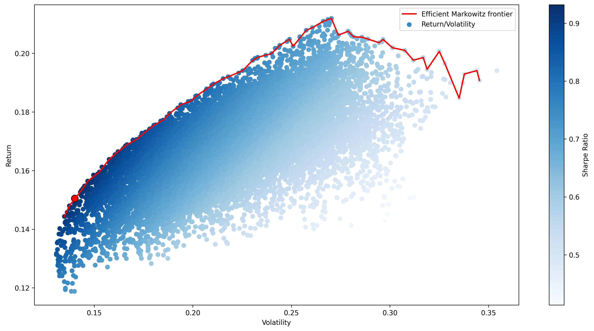

<div align="center">

# 📈 Portfolio-Optimization-Markowitz

**Monte Carlo approximation of the Markowitz Efficient Frontier — from discretionary trading to quantitative finance.**


</div>

---

## 📑 Table of Contents

1. [Project Motivation & My Transition](#-project-motivation--my-transition)
2. [Project Overview (V1)](#-project-overview-v1)
3. [Theoretical Background](#-theoretical-background)
4. [Methodology: Monte Carlo Approach](#-methodology-monte-carlo-approach)
5. [Results](#-results)
6. [Limitations of V1](#-limitations-of-v1)
7. [Future Work / Roadmap](#-future-work--roadmap)
8. [Installation & Usage](#-installation--usage)
9. [Tech Stack](#-tech-stack)
10. [About the Author](#-about-the-author)
11. [License](#-license)

---

## 🎯 Project Motivation & My Transition

I am an Electrical Engineer with **3 years of experience as a discretionary trader** on a **real, audited account**, closing that period with a **Profit Factor of 1.27** and an average **Risk/Reward ratio of 1:2**.

On paper, the system was profitable. In practice, I realised it was **not sustainable in the long run**. The edge depended on my own judgement, and judgement is vulnerable to fatigue, loss aversion, overconfidence, recency bias and inconsistent execution. Two identical setups could lead to two different decisions depending on my state of mind. A strategy that cannot be executed consistently cannot be reliably measured, improved, or scaled.

That insight was the turning point. I decided to remove the human factor from the decision loop and replace intuition with **data, statistics and mathematical models**. This is my transition from *discretionary trading* to *algorithmic trading and quantitative finance*.

This repository is the **first step of that journey**: a rigorous, reproducible treatment of one of the foundational problems of quantitative finance, **portfolio construction**. Rather than asking *"which assets feel right?"*, the question becomes *"what allocation maximises risk-adjusted return, given the data?"*

> 🎓 This project is part of the portfolio I am building to apply to top-tier Quantitative Finance master's programmes.

---

## 🔍 Project Overview (V1)

**Version 1** is an interactive Jupyter Notebook that:

- Lets the user **select 4 assets** from a universe of 26 tickers (large-cap equities, the S&P 500 ETF and a gold ETF) through an interactive `ipywidgets` dropdown interface.
- Downloads **daily adjusted price data (2015–2026)** via `yfinance`.
- Performs exploratory analysis: individual price performance, cumulative returns and a **correlation heatmap**.
- Runs a **Monte Carlo simulation with 15,000 random portfolios** to approximate the efficient frontier.
- Identifies the **maximum Sharpe Ratio portfolio** and plots it against the frontier.

📓 **Notebook:** [`portfolio-optimization-montecarlo.ipynb`](./portfolio-optimization-montecarlo.ipynb)

<!-- Add your efficient frontier plot here -->
<!--  -->

---

## 🧮 Theoretical Background

**Modern Portfolio Theory (MPT)**, introduced by Harry Markowitz in 1952, formalises diversification. Its central idea is that an asset should not be judged in isolation, but by how it contributes to the **risk and return of the whole portfolio**. Because assets are imperfectly correlated, combining them can reduce portfolio risk without proportionally sacrificing return.

Consider a portfolio of $n$ assets with weight vector $\mathbf{w} = (w_1, \dots, w_n)^\top$, subject to the budget constraint $\sum_{i=1}^{n} w_i = 1$ and, in this project, no short-selling ($w_i \ge 0$).

### Expected Portfolio Return

$$
\mu_p = \mathbb{E}[R_p] = \sum_{i=1}^{n} w_i \, \mu_i = \mathbf{w}^\top \boldsymbol{\mu}
$$

### Portfolio Variance

$$
\sigma_p^2 = \sum_{i=1}^{n}\sum_{j=1}^{n} w_i \, w_j \, \sigma_{ij} = \mathbf{w}^\top \Sigma \, \mathbf{w}
$$

where $\boldsymbol{\mu}$ is the vector of expected asset returns and $\Sigma$ is the covariance matrix of asset returns. The off-diagonal terms $\sigma_{ij}$ are what capture the **diversification effect**.

### Sharpe Ratio

$$
\text{Sharpe} = \frac{\mu_p - R_f}{\sigma_p}
$$

where $R_f$ is the risk-free rate (set to **2%** in this project).

### Efficient Frontier

The **efficient frontier** is the set of portfolios that offer the **highest expected return for a given level of risk** (equivalently, the lowest risk for a given expected return). Any portfolio below the frontier is *sub-optimal*: it is possible to earn more return for the same risk.

---

## 🎲 Methodology: Monte Carlo Approach

Rather than solving the optimisation problem analytically, V1 uses a **heuristic, simulation-based approach**:

1. **Data acquisition.** Download daily close prices for the 4 selected assets and drop missing values.
2. **Log returns.** Compute $r_t = \ln\left(\frac{P_t}{P_{t-1}}\right)$.
3. **Annualisation.** Annualised mean returns and covariance matrix use 252 trading days:
   $\boldsymbol{\mu} = 252 \cdot \bar{\mathbf{r}}$ and $\Sigma = 252 \cdot \text{Cov}(\mathbf{r})$.
4. **Random weight generation.** For each of the **15,000 iterations**, draw random weights and normalise them so that $\sum w_i = 1$.
5. **Portfolio metrics.** For each weight vector, compute $\mu_p$, $\sigma_p$ and the Sharpe Ratio.
6. **Frontier approximation.** Split the volatility axis into 50 equally spaced bins and keep the **highest-return portfolio in each bin**. Together these points trace an approximation of the efficient frontier.
7. **Optimal portfolio selection.** Select the weight vector that **maximises the Sharpe Ratio**.

```python
for it in range(num_iter):
    weights = np.random.random(4)
    weights = weights / np.sum(weights)          # enforce sum(w) = 1

    ret_portf[it] = np.sum(portfolio_log.mean() * weights * 252)
    vol_portf[it] = np.sqrt(weights.T @ (portfolio_log.cov() * 252) @ weights)
    sp[it]        = (ret_portf[it] - ret_fix) / vol_portf[it]
```

By the law of large numbers, with enough random samples the cloud of portfolios densely covers the feasible region, so its upper boundary converges towards the true efficient frontier.

---

## 📊 Results

Example output for a portfolio of **AAPL, GLD, META and ADBE** (daily data 2015–2026, 15,000 simulations, $R_f = 2\%$):

| Asset | Optimal Weight |
|:------|:--------------:|
| **AAPL** (Apple) | 33.87% |
| **GLD** (Gold ETF) | 61.77% |
| **META** (Meta Platforms) | 3.09% |
| **ADBE** (Adobe) | 1.28% |

| Portfolio Metric | Value |
|:-----------------|:-----:|
| Expected Annual Return | ≈ 14.7%* |
| Annual Volatility | ≈ 13.6%* |
| **Sharpe Ratio (max)** | **0.93** |

<sub>*Return and volatility figures are illustrative approximations consistent with the simulated Sharpe Ratio. Weights and the Sharpe Ratio are taken directly from the notebook output. Results vary between runs because of the stochastic nature of the method, and they depend on the selected assets and sample period.</sub>

### 🧠 Key Observations

- **Diversification drives the result.** The optimiser allocates heavily to **gold**, a low-volatility asset with low correlation to equities, and only a small amount to higher-volatility growth stocks. Highly profitable but volatile assets receive a *smaller* weight than less profitable but more stable ones.
- **Sharpe Ratio interpretation.** A value between 0 and 1 indicates a profitable portfolio, but one where the risk taken is not strongly compensated.
- **How to improve it.** Adding an asset that is both *profitable* and *inversely correlated* with the rest increases the numerator (return) and decreases the denominator (volatility) at the same time.

---

## ⚠️ Limitations of V1

Transparency about methodology is a core part of quantitative work. V1 has several known limitations:

| Limitation | Description |
|:-----------|:------------|
| **Stochastic, not exact** | Results change on every run (unless a seed is fixed). The solution is an *approximation*, not the true optimum. |
| **Inefficient search** | Random sampling scales poorly: the number of samples needed to cover the feasible space grows rapidly with the number of assets (curse of dimensionality). |
| **Sampling bias** | Normalising i.i.d. uniform draws does **not** yield a uniform distribution over the weight simplex. Portfolios concentrated in a single asset are under-sampled, so the extremes of the frontier are poorly represented. |
| **Approximate frontier** | The frontier is built from binned maxima, so its accuracy depends on the number of bins and the density of samples. |
| **In-sample estimation** | $\boldsymbol{\mu}$ and $\Sigma$ are estimated from historical data and assumed stationary. Mean-variance optimisation is notoriously sensitive to estimation error, especially in $\boldsymbol{\mu}$. |
| **Simplified assumptions** | No transaction costs, taxes, slippage or rebalancing. Returns are treated as well described by their first two moments. |

These limitations are what motivate Version 2.

---

## 🚀 Future Work / Roadmap

> **Version 2 (V2) is currently in development.**

The goal of V2 is to **remove randomness from the optimisation** and solve the problem exactly using **convex optimisation with [`cvxpy`](https://www.cvxpy.org/)**.

### V2: Exact Optimisation via Quadratic Programming

Since $\Sigma$ is symmetric positive semi-definite, the Markowitz problem is a **convex Quadratic Program (QP)**, so it has a global optimum that can be found efficiently and deterministically:

$$
\begin{aligned}
\min_{\mathbf{w}} \quad & \mathbf{w}^\top \Sigma \, \mathbf{w} \\
\text{s.t.} \quad & \boldsymbol{\mu}^\top \mathbf{w} \ge \mu_{\text{target}} \\
& \mathbf{1}^\top \mathbf{w} = 1 \\
& \mathbf{w} \ge 0
\end{aligned}
$$

Solving this for a range of $\mu_{\text{target}}$ values traces the **exact efficient frontier**. The maximum Sharpe Ratio portfolio can be recovered through a convex reformulation (rescaling to $\mathbf{y} = \mathbf{w}/\kappa$, which keeps the problem a QP).

### Roadmap

- [x] **V1:** Monte Carlo simulation, interactive asset selector, Sharpe Ratio maximisation
- [ ] **V2:** Exact QP formulation with `cvxpy`, deterministic efficient frontier
- [ ] **V2:** Minimum-variance and maximum-Sharpe portfolios, with a side-by-side comparison against the V1 Monte Carlo estimate
- [ ] **V2:** Realistic constraints: position limits, sector exposure, turnover, transaction costs
- [ ] **V2:** Scale from 4 assets to a larger universe (e.g. S&P 500 constituents)
- [ ] **V3:** Robust estimation (Ledoit-Wolf covariance shrinkage) and out-of-sample **walk-forward backtesting**
- [ ] **V3:** Alternative risk measures (CVaR) and Black-Litterman views

---

## ⚙️ Installation & Usage

```bash
# 1. Clone the repository
git clone https://github.com/<your-username>/Portfolio-Optimization-Markowitz.git
cd Portfolio-Optimization-Markowitz

# 2. (Optional) Create a virtual environment
python -m venv venv
source venv/bin/activate        # Windows: venv\Scripts\activate

# 3. Install dependencies
pip install pandas numpy matplotlib seaborn yfinance ipywidgets jupyter

# 4. Launch the notebook
jupyter notebook portfolio-optimization-montecarlo.ipynb
```

**How to use it:**

1. Run the first cells to load the libraries and the asset selector.
2. Choose **4 distinct assets** from the dropdown menus and click **Download data**.
3. Run the remaining cells to explore the data, run the simulation and visualise the efficient frontier and the optimal weights.

---

## 🛠️ Tech Stack

| Category | Tools |
|:---------|:------|
| **Language** | Python |
| **Data & Numerics** | `pandas`, `numpy` |
| **Visualisation** | `matplotlib`, `seaborn` |
| **Market Data** | `yfinance` |
| **Interactivity** | `ipywidgets`, Jupyter Notebook |
| **Planned (V2)** | `cvxpy`, `scipy` |

---

## 👤 About the Author

**Electrical Engineer · Discretionary Trader turned Quantitative Finance Candidate**

I hold a background in Electrical Engineering, which gave me a strong foundation in mathematics, signal analysis and systems thinking. I spent **3 years trading discretionarily on a real, audited account** (Profit Factor 1.27, Risk/Reward 1:2). That experience taught me, first-hand, the limits of intuition-driven decisions and the value of a systematic, data-driven process.

I am now focused on building the quantitative toolkit (statistics, optimisation, stochastic modelling and algorithmic trading) to make investment decisions **objective, testable and reproducible**.

🎯 **Goal:** Pursue a Master's in Quantitative Finance at **Erasmus University Rotterdam**.

📫 **Connect with me:**
[](https://www.linkedin.com/in/<your-profile>)
[](https://github.com/<your-username>)

---

## 📄 License

This project is licensed under the **MIT License**. See the [LICENSE](./LICENSE) file for details.

---

<div align="center">

⚠️ **Disclaimer:** This project is for educational and research purposes only and does not constitute financial advice.

⭐ If you find this project useful, consider giving it a star!

</div>